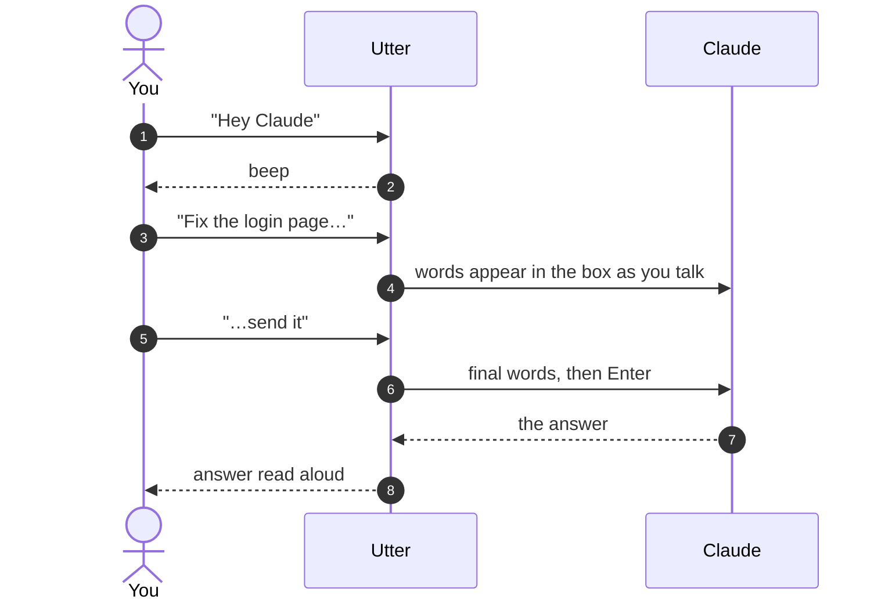
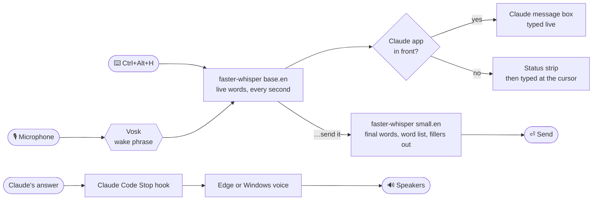

<div align="center">


[](#-what-you-can-say)

[](#-install)
[](#-install)
[](#-privacy)
[](LICENSE)

[](https://github.com/suv0/utter/actions/workflows/tests.yml)

**Say "Hey Claude". Talk. Watch your words appear. Say "send it". Hear the answer.**



</div>

> [!NOTE]
> Utter is an unofficial community project. It is not made by, or connected with, Anthropic.

## ✨ Why Utter

<table>
<tr>
<td width="33%" valign="top">

### 🎙️ Talk, don't type
Say **"Hey Claude"** or press **Ctrl+Alt+H**. Your words appear in Claude's box as you speak.

</td>
<td width="33%" valign="top">

### ✋ You decide when to send
Pausing to think never sends. End with **"send it"**, or press the shortcut again.

</td>
<td width="33%" valign="top">

### 🔊 Hear the answer
Claude's reply is read aloud, without the code and tables. **"Repeat that"** plays it again.

</td>
</tr>
<tr>
<td valign="top">

### 🪟 Works anywhere
In the Claude app, or wherever your cursor is: Claude Code in a terminal, an editor, a chat.

</td>
<td valign="top">

### 🔒 Private by default
Speech recognition runs **on your PC**. Your voice is never uploaded.

</td>
<td valign="top">

### ♿ Built for access
No mouse, keyboard or screen needed. Beeps, spoken problems, a large high-contrast strip.

</td>
</tr>
</table>

## 🗣️ What you can say

Say **Hey Claude** (or press **Ctrl+Alt+H**) first.

| | Say | What happens |
| :---: | --- | --- |
| 💬 | *anything*, then …**send it** | Types it and sends it. "send that", "that's it" and "over and out" work too |
| 📨 | **send it** | Sends what's already typed |
| 🧹 | **scratch that** | Clears the box |
| 👂 | **read it back** | Reads your message aloud |
| ✏️ | **change** *word* **to** *word* | Fixes a word: "change staging to production" |
| 🔤 | **spell** *letters* | "spell kilo uniform bravo echo" types *kube*. Say "capital" for a capital letter |
| ⌨️ | **type** *command* | Types a command word instead of running it: "type stop" types *stop* |
| 🔁 | **repeat that** | Reads Claude's last answer again |
| 🤫 | **quiet** | Stops reading the current answer |
| ⏹️ | **stop** | Stops Claude's work (presses Esc) |
| 🔈 | **voice off** / **voice on** | Turns spoken answers off or on |
| ❓ | **help** | Shows the command list on the strip |

> [!TIP]
> Spelling works best with the NATO alphabet (alpha, bravo, charlie…). Single letters are easy to mishear.

## 🔄 How a message travels



## 🚦 The status strip

A small strip sits at the bottom right of your screen and shows what Utter is doing.

| Dot | Means |
| :---: | --- |
| 🟢 | Waiting for "Hey Claude" |
| 🔴 | Listening. It shows where the words are going, and your words as they're heard |
| 🟠 | Working, or a problem it's telling you about |
| ⚪ | Paused |

Drag it anywhere, and it remembers the spot. Click **?** for the commands. The tray icon near the clock can pause
listening, stop the voice, show help, open the settings, restart and quit.

## 📦 Install

1. **Download** this project: **Code → Download ZIP**, then unzip it.
   Or, with git: `git clone https://github.com/suv0/utter`.
2. **Double-click `install.cmd`.**
3. **Click the Claude app's message box once**, then say **"Hey Claude"**.

<details>
<summary><b>What the installer does</b></summary>

<br>

- Finds Python 3.11 or newer, and offers to install Python 3.12 if there is none.
- Makes a private Python environment in `%USERPROFILE%\.utter`, so it never touches your other Python projects.
- Downloads the speech models (about 640 MB, only once).
- Turns on spoken answers in Claude Code.
- Adds Utter to the Start menu and sets it to start with Windows.
- Checks your microphone, then starts Utter.

To **update**, download the new version and run `install.cmd` again. Your settings are kept, and new settings are
added with their defaults.

</details>

<details>
<summary><b>Requirements</b></summary>

<br>

- Windows 10 or 11.
- The [Claude desktop app](https://claude.ai/download), or Claude Code in a terminal.
- Python 3.11, 3.12 or 3.13. The installer can install it for you.
- A microphone. Headphones are best, so the mic doesn't hear the answers being read aloud.
- About 1 GB of disk space, and an internet connection for the first install.

</details>

## 🎯 Where the words go

| In front | Words go to | While you talk |
| --- | --- | --- |
| **Claude app** | Its message box (click it once after installing) | Words appear live in the box. Every command works |
| **Any other app** | Wherever your cursor is | Words show on the strip, then are typed once when you finish |

To always use one, set `target` to `"claude-app"` or `"cursor"`.

## ♿ Accessibility

- **No mouse or keyboard needed** after setup. Every command works by voice.
- **No screen needed.** Beeps mark the start and end of listening, problems are spoken, and "read it back" and
  "repeat that" let you hear your message and the answer.
- **A shortcut instead of the wake phrase**, for noisy rooms, or if the wake phrase is hard for you to say.
- **A large, high-contrast strip:** `strip_size = "large"`, `high_contrast = true`.
- **Slower or faster speech:** `speaking_rate = -30` (slower) or `25` (faster).
- **More time to think:** raise `quiet_seconds`. Nothing sends until you say so.
- **Unclear messages are never sent.** When Utter isn't sure it heard you, it types the words and reads them back.

## ⚙️ Settings

Open **tray icon → Open the settings file** (`%USERPROFILE%\.utter\config.toml`). Every setting has a comment. After a
change, choose **Restart** in the tray menu.

<details>
<summary><b>The useful ones</b></summary>

<br>

```toml
hotkey = "ctrl+alt+h"       # or "" for none
send_mode = "phrase"        # "pause" also sends when you stop talking for pause_seconds
target = "auto"             # "claude-app" or "cursor" to always use one
words = ["Kubernetes", "PostgreSQL", "Priya"]   # names and jargon to expect
replacements = { "get hub" = "GitHub" }         # "what it hears" = "what to type"
remove_fillers = true       # take out "um" and "uh"
language = "en"             # "de", "es", "fr", "hi", "bn", ...: run install.cmd again after changing it
voice_engine = "edge"       # "windows" for the offline Windows voices
voice = "en-US-AndrewMultilingualNeural"   # any Edge voice: python -m edge_tts --list-voices
speaking_rate = 0           # -30 slower, 25 faster
cue_sounds = true           # beeps instead of saying "Yes?"
quiet_seconds = 15.0        # stop listening after this much quiet, leaving the text unsent
speaking_level = 0.008      # raise it in a noisy room
microphone = ""             # part of a microphone's name; empty means the Windows default
final_model = "small.en"    # "base.en" is faster on slow computers, "medium.en" is more accurate
strip_size = "normal"       # or "large"
high_contrast = false
```

</details>

## 🔒 Privacy

| What | Where it happens |
| --- | --- |
| Hearing the wake phrase | 🟢 On your PC ([Vosk](https://alphacephei.com/vosk/)) |
| Turning your voice into text | 🟢 On your PC ([faster-whisper](https://github.com/SYSTRAN/faster-whisper)) |
| Reading answers aloud, `voice_engine = "windows"` | 🟢 On your PC |
| Reading answers aloud, `voice_engine = "edge"` (default) | 🟠 The text is sent to Microsoft's Edge voice service ([edge-tts](https://github.com/rany2/edge-tts)) |

Utter keeps no recordings and sends nothing anywhere else. If the Edge voice can't be reached, it uses the Windows
voice.

## 🩺 Troubleshooting

<details>
<summary><b>The strip says it can't use the microphone</b></summary>

<br>

Open **Settings → Privacy & security → Microphone**. Turn on *Microphone access*, *Let apps access your microphone*
and *Let desktop apps access your microphone*. Then start Utter again.

</details>

<details>
<summary><b>It says "Click the Claude message box once"</b></summary>

<br>

Utter hasn't seen you click a Claude message box yet, or the window moved. Click into the box, then try again.

</details>

<details>
<summary><b>It doesn't hear "Hey Claude"</b></summary>

<br>

Speak at a normal volume, close to the mic. Check that the right microphone is the Windows default, or set
`microphone` in the settings. The shortcut (Ctrl+Alt+H) always works.

</details>

<details>
<summary><b>The strip says the shortcut is taken by another app</b></summary>

<br>

Another program already uses that key combination. Set `hotkey` to a different one, such as `"ctrl+shift+f9"`, then
choose Restart in the tray menu.

</details>

<details>
<summary><b>It typed in the wrong app</b></summary>

<br>

With `target = "auto"`, words go to the app that was in front when you woke Utter, and the strip shows which one.
Set `target = "claude-app"` to always use the Claude app.

</details>

<details>
<summary><b>It keeps mishearing a name</b></summary>

<br>

Add it to `words`, or add the wrong version to `replacements`.

</details>

<details>
<summary><b>Check everything at once</b></summary>

<br>

```powershell
& "$env:USERPROFILE\.utter\venv\Scripts\python.exe" -m utter doctor
```

The log is at `%USERPROFILE%\.utter\utter.log`.

</details>

## ⚠️ Limits

- **Windows only.**
- **The Claude app's box is found through Windows UI Automation**, where it's named "Prompt". A Claude app update could
  change that. Until Utter is updated, set `target = "cursor"` and click into the box yourself.
- **Utter replaces what's in the Claude box while you talk.** Text that was already there is kept at the front. Don't
  type in the box while Utter is listening.
- **The wake phrase and commands are English**, even when `language` is set to another language.
- **"Hey Claude" is heard as common English words**, such as "hey cloud", so similar-sounding speech can wake it.

## 🧹 Uninstall

Double-click **`uninstall.cmd`**. It stops Utter, takes its hook out of Claude Code, and removes the shortcuts, the
Python environment and the models. Your settings file is kept. Run `uninstall.ps1 -All` to remove that too.

## 🛠️ How it works



<details>
<summary><b>The code</b></summary>

<br>

| File | Job |
| --- | --- |
| `src/utter/app.py` | Listening loop and one message, start to finish; the commands |
| `src/utter/targets.py` | Where the words go: the Claude box, or wherever the cursor is |
| `src/utter/words.py` | Commands, the send phrase, spelling, fillers and replacements |
| `src/utter/voice.py` | Edge and Windows voices, beeps |
| `src/utter/hotkey.py` | The keyboard shortcut |
| `src/utter/ui.py` | Status strip and tray icon |
| `src/utter/speak_reply.py` | The Claude Code hook that reads answers aloud |
| `src/utter/setup.py` | Models, hook, shortcuts, microphone check |
| `src/utter/settings.py` | Settings and file locations |

Run the tests with `python -m pytest`. `tests/test_listening.py` plays recorded speech through the whole listening
loop. It runs when the speech models are installed and the internet is reachable, and is skipped otherwise.

</details>

## 🙏 Ideas borrowed from

The word list, filler removal and the "type" and "correct" commands follow Windows Voice Access and Wispr Flow. The
choice between sending on a phrase or on a pause follows mcp-voice-hooks. Typing at the cursor follows Bol. Checking
unclear messages follows handsfree-claude.

## 📄 License

MIT. See [LICENSE](LICENSE). The speech models are downloaded from their own projects under their own licenses: Vosk
(Apache 2.0) and Whisper (MIT).

<div align="center">


</div>
